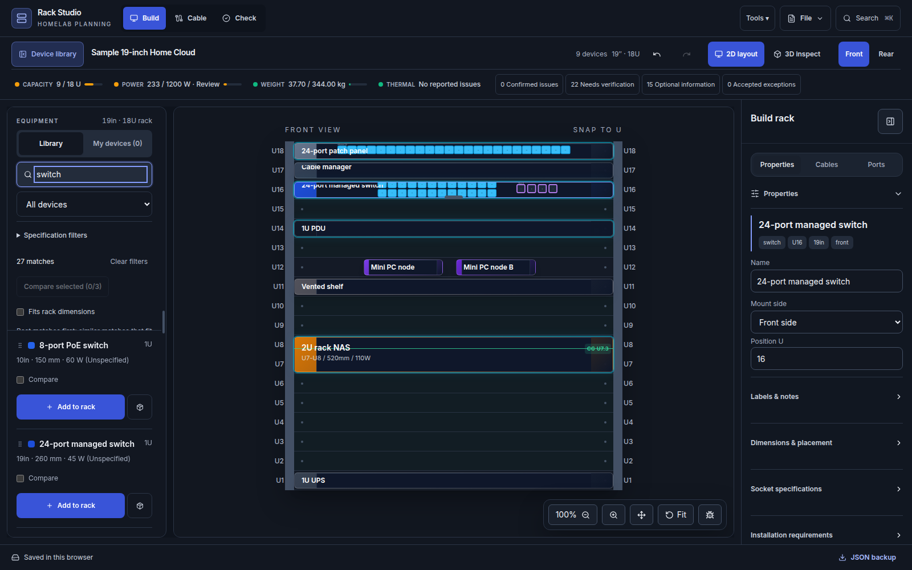
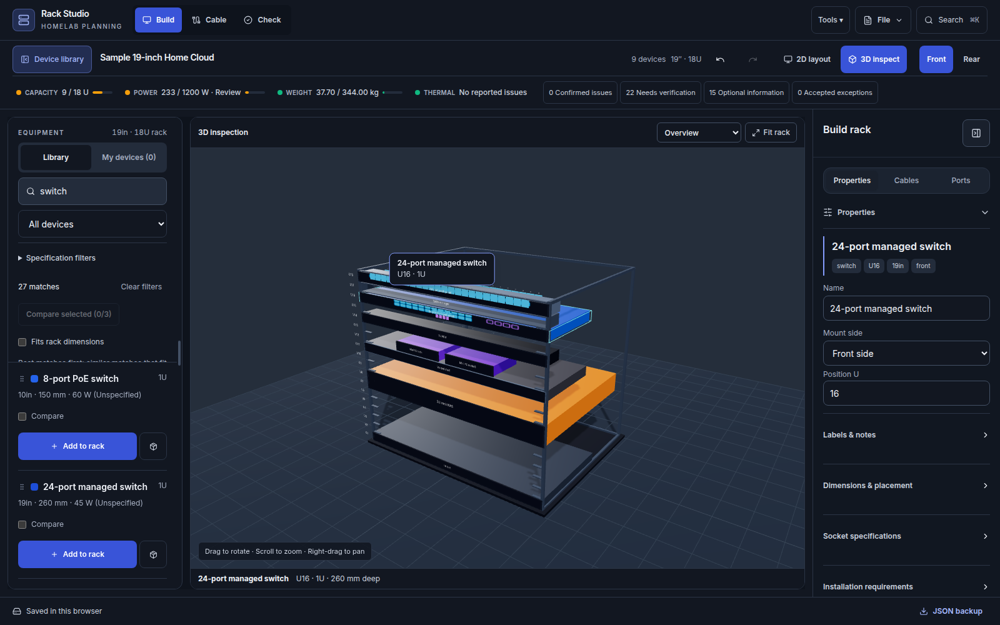
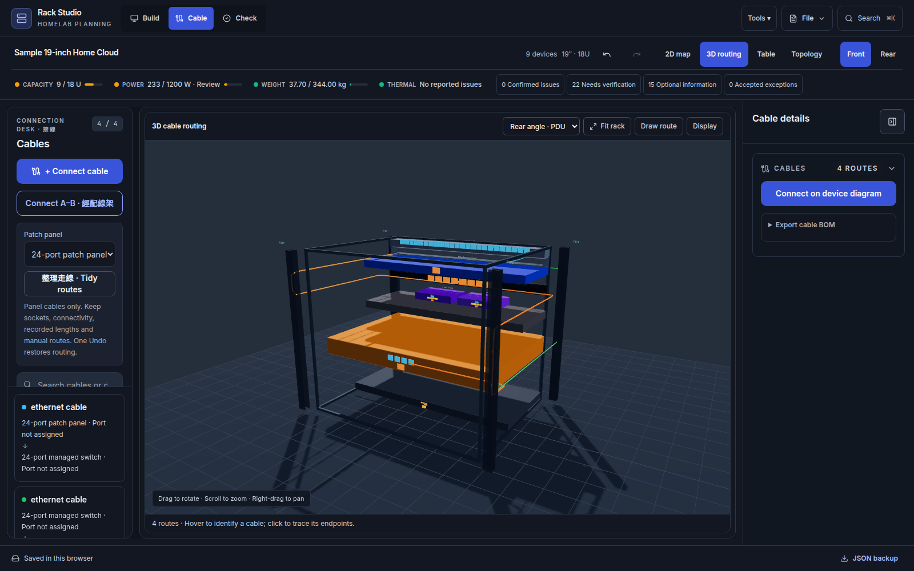
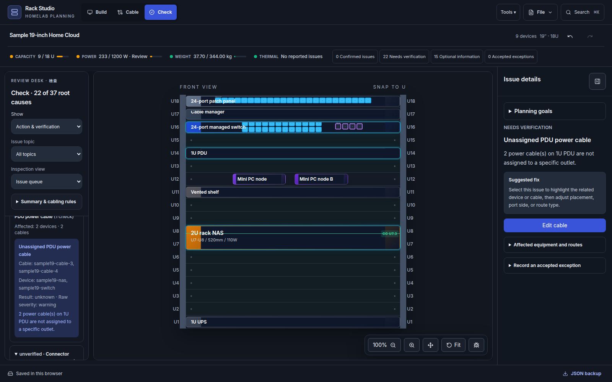

# Homelab Rack Simulator

喺瀏覽器規劃 10 吋或 19 吋 homelab 機架：用 2D 放設備、3D 睇深度同插口、規劃接線，再檢查空間、重量、電力同維護需要。

[English](../README.md) · [使用指南](USER_GUIDE.zh-Hant.md) · [文件索引](README.md) · [線上示範](https://breezyjack459.github.io/HomeLab_Rack_Simulator/)

本文件對應 `main` 嘅 `c0d2038`（2026-10-01），並於 **2026-10-21** 再對過源碼。GitHub Pages 喺 2026-10-01 CI 通過後發佈咗呢個 commit。之後嘅 commit 要同一套部署流程通過先會上線。

## 開始使用

```bash
npm ci
npm run dev
```

開啟 [本機應用](http://127.0.0.1:5173/HomeLab_Rack_Simulator/)。Vite 固定用 5173 埠，並監聽本機所有網絡介面。同一個可信任 LAN 嘅裝置可開 `http://YOUR_LAN_IP:5173/HomeLab_Rack_Simulator/`。`npm run dev:lan` 會明確指定 LAN 模式；每個瀏覽器有獨立儲存資料。

## 而家嘅工作流程

| 位置 | 用途 |
|---|---|
| **Build** | 用 Library 搵範本、My devices 管理未上架設備、2D 拖放、3D 檢視同修改屬性。冇已儲存計劃嘅瀏覽器會打開 **Start small: one feed**。**File → Load sample** 亦有 **Trace A/B and patch paths**、**Repair three conflicts** 同舊有 Legacy examples。 |
| **Cable** | 建立接線、用 **Connect A–B** 經一至兩塊配線架規劃、整理配線架走線而唔改端點，以及 2D map／3D routing／Topology／Table 同自訂繪線。窄螢幕嘅 **Display** 會將 Clean／Realistic 同圖層開關留喺 3D 畫面入面。依賴預設啟用嘅 Cable Management。 |
| **Check** | 按根因分組（已確認、需要核實、可選資料、已接受例外），再改佈局或記錄有理由嘅例外。**Planning goals** 設定供電、復原同維護移動意圖。 |
| **Tools** | 啟用 Operations、Planning、Fleet。Port Labels 同 Cable Labels 係可選檢視。Settings 入面管理機架、插件同外觀。 |

預設介面係 Rack Studio。Cable Management 同 Governance Tools 一開始啟用。Operations、Planning、Fleet、Port Labels 同 Cable Labels 要手動開啟，程式先按需載入。已儲存嘅啟用清單會保持原樣，重新載入唔會把未列出嘅功能包重新打開。診斷用經典介面可將 `localStorage["rack-simulator-new-shell"]` 設為 `"0"` 再重新載入。詳見[插件行為](dev/ARCHITECTURE.md#plugins)。

## 實際介面預覽

以下係 **2026-10-21** 用本機 Vite（`main` `c0d2038`）同內置範例重新擷取嘅 Rack Studio 畫面；範例本身嘅警告亦有保留。[完整截圖導覽](SCREENSHOTS.md)另有庫存、Topology、自訂繪線、薄托盤、0U PDU、插件同平板畫面。

### Build：2D 佈局

左邊搜尋設備，中間安排 U 位，右邊修改所選設備。



### 3D 檢視

用視角選單檢查設備深度、插口同前後空間。



### Cable：3D 走線

從後方檢查資料線同電源線，旁邊保留線材清單同連接操作。



### Check：問題詳情

Check 會按根因分組。範例機架保留電力發現，包括未知插座數量同未分配電源線。



## 已有功能

- 前後面 2D 拖放、U 位吸附、重疊／保留位檢查、深度警告，以及設備尺寸篩選。
- 每個機架嘅 **My devices** 庫存；未上架设备唔計入機架用電、重量同 U 位。
- 薄托盤同設備共用 U、實際設備高度、頂部淨空，以及簡化 3D 打印支架。
- 0U PDU 嘅實際長度、離底高度、安裝區同插座方向。
- 學習示例：全新瀏覽器打開虛構 6U **Start small: one feed**。**Trace A/B and patch paths** 同 **Repair three conflicts** 要手動載入；四個舊佈局留喺 **Legacy examples**。替換目前機架前會先問。示例 Check 冇待辦，只表示那些已寫明嘅假設內部一致。
- **Connect A–B**（新嘅 patch-cord 或 permanent-link 線段、重用現有骨幹線、前後插口跳線唔計入採購）、整理配線架走線而保留端點同已記錄長度、自動走線、自訂 Draw route／Redraw route，同 blocked 路線提示。
- 3D 相機視角、選取聚焦、面板材質同插口；Clean／Realistic 線材顯示。窄螢幕 Cable 嘅 **Display** 留喺畫面內，並可捲動到走線樣式同圖層。
- 電力、重量、散熱、深度、層板承托、UPS 同可維護性檢查，按根因分組。Planning goals 同已接受例外會隨機架同 workspace 備份保存。
- 可選嘅營運、變更規劃、多機架／跨機架連線、Port Labels，以及可列印嘅線材端點標籤（Cable Labels）。
- 自動儲存、當次工作階段 undo／redo、機架 JSON 匯入／匯出、2D PNG，同儲存錯誤復原提示。Fleet 支援完整 workspace 匯入／匯出。

詳細路徑、薄層板例子、繪線步驟同資料復原請睇[使用指南](USER_GUIDE.zh-Hant.md)。

## 資料同限制

呢個係純前端應用，冇共用後端或帳戶同步；轉裝置需要 JSON。機架 JSON 同完整 workspace JSON 範圍唔同，備份多機架資料要用 workspace 匯出。

設備尺寸、用電、重量、散熱同噪音都係規劃輸入。請按實物確認通用範本同自訂數值；[裝置規格核對表](DEVICE_SPEC_AUDIT.zh-Hant.md)保留之前核對嘅來源、日期同未確認項目。更新範本唔會覆蓋已儲存設備。

打印支架只係示意，唔會產生或匯入 STL／CAD。採購長度係 Clean 同 Realistic 3D 中心線之中較長者，再加一次安裝餘量，然後對上有庫存嘅長度。目前顯示樣式畫出嚟嘅係未加呢段餘量嘅中心線。受阻路線唔會估算，已記錄線長亦唔會被呢兩個數字覆蓋。[已知限制](dev/KNOWN_ISSUES.md)有更完整說明。

## 開發同驗證

技術：React 18、TypeScript 5.7、Vite 6、Zustand 5、Tailwind CSS 3、Three.js 0.171、React Three Fiber 8、Drei 9。

```bash
npm test
npm run test:plugins
npx playwright install chromium
npx playwright test
npm run build
node scripts/check-bundle-size.mjs
npm run preview
```

`npm run smoke:cables` 要先開 dev server，用嚟更新走線截圖。eager JavaScript 上限係 500 KB（壓縮前，入口加 modulepreload）；3D 同可選功能按需載入。呢次文件更新唔代表已重新跑過所有測試或量度 bundle。

[開發指南](dev/DEVELOPMENT.md)列出測試範圍同 CI；[架構](dev/ARCHITECTURE.md)解釋 store、走線同插件。推送 `main` 或手動觸發會行部署流程：CI 通過後先發佈 Node 22 嘅 `production-dist`，打包時唔會重新建置。檢查失敗就唔會換走現有 Pages 網站。預設 base path 係 `/HomeLab_Rack_Simulator/`。
